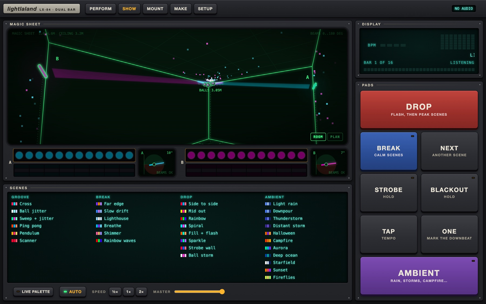
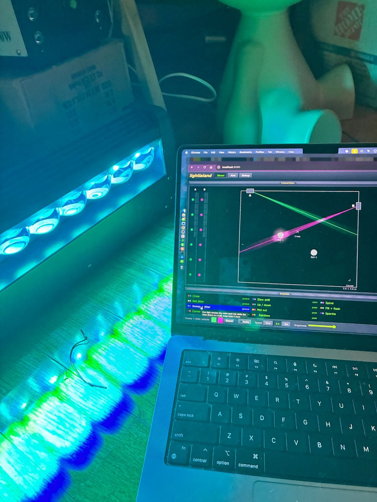

# lightlaland



Listens to your vinyl mix on the Mac and drives the two 250W beam-curtain bars over Art-Net,
with a control page for the Mac or iPad.

The bars hang **horizontally on the walls** (about 8 ft up), so each one tilts its curtain
of beams up and down in the plane at right angles to its wall: level across the room,
straight up, back toward the wall. The page looks like an old lighting desk: rubber keys, a
teal VFD and a green radar "magic sheet" of the room. The sheet shows the room in 3D from the
corner across from the disco balls (ROOM), with the curtains, the LED side's wash and the balls'
reflections, or from above (PLAN); the keys are at its bottom right.

- **Perform** (opens first on an iPad or phone): both bars and their tilt at the top, with the
  magic sheet folding out below. Then Tempo (Tap, One, phrase start, nudge, phrase length),
  Palette (two colour ranges, primary and secondary: drag their circles round the colour disc,
  and make a circle bigger for more variety; Swap, Surprise me, or a preset), and Scenes: the
  set (Everyday / Halloween / Window), Groove / Break / Drop / Ambient, which pick a random scene
  of that group from the set (Drop also flashes and restarts the phrase), Strobe freq, and the
  list: filter it by tag (beams, washers, strobes, disco ball), tick which scenes auto mode may
  pick (or all on / all off for what's listed), or tap one to play it. Auto, Strobe and Blackout
  stay at the bottom. On a phone only one section is open at a time.
- **Show** (the Mac): magic sheet, the VFD (BPM, beats, phrase, spectrum), big pads, the set,
  Strobe freq, the scene list (with the same tag filter and auto boxes), the live palette's two
  ranges (tap to edit, or Surprise me), speed and master brightness.
- **Mount**: set each bar's tilt (point the beams straight up, then say which way the room is),
  check it, and save aims at the ball cluster. **Beams stay off
  until this is done.**
- **Make**: the scene maker. Edit any scene (colour ranges, tags, movement, beams, the LED strip
  and its second row, whites, effects such as lightning, strobe bursts and fills) while it plays
  on the lights, or start one from scratch or from a copy. Ticking "Keeps its own colours" stops
  the live palette from changing a scene (rainbows, fire, rain...).
- **Setup**: beam safety, room size and ceiling height, where the bars and targets are (drag
  them on the magic sheet), the lights' network settings, audio, sync, a channel test, and the
  output switch.

## First light



One of the bars on its first test, on the floor before it was mounted, with an early version
of the control page.

## Beam safety

Beams only light while they point between the lowest and highest allowed angle (by default
level, through straight up, to level into the wall: never below level, so never into the
crowd). They also stay dark while a bar spins, while the head may still be travelling through
an unsafe angle (the app tracks every position the head could physically be at), at start-up,
and until a bar's tilt has been set on the Mount tab. Each bar can also have its own limit:
the first CH1 step toward the room where its beams would reach people (Setup > Beam safety).
The LED side isn't limited. Setup > Beam
safety has the angles and a master switch; a highest angle above 180 also allows beams pointing
down the wall under the bar (270 = straight down that side), and one just over 90 keeps them
from ever tilting back past straight up (for the windowsill, below).

Movement is smoothed by default (Setup > Music): the motor speed follows how fast the scene
moves, so slow tilts glide instead of jumping one 2-degree step at a time. `python -m tests.test_safety` runs every scene
against a simulated head and fails if a beam is ever lit pointing low.

## Halloween

Pick the **Halloween** set (Perform > Scenes, or above the scene list on Show): auto mode and the
Groove / Break / Drop / Ambient pads then only play its 13 scenes (Pumpkin patch, Ghost train,
Monster mash, Skeleton dance, Witch's cauldron, Witching hour, Tell-tale heart, Graveyard fog,
It's alive!, Poltergeist, Bat swarm, Halloween, Haunted house). They put patterns on the beams
and the LED side (ghosts drifting, eyes that open and blink, a dying bulb, a heartbeat, bats
fluttering) and keep the whites for the odd strobe burst. **Strobe freq** (Off, ¼×, ½×, 1×, 2×,
4×) scales those bursts and any lightning in every scene; Off stops them all.

**Window** is for the bars on the windowsill, facing the street. Its nine scenes keep the beams
35-75 degrees up, high over the street, and never turn the LED side out (that would point the
beams back into the house). Eight are for the children walking past, with no strobes or
lightning: Pumpkin parade, Candy corn, Friendly ghosts, Bat flight, Witch's brew, Monster disco
(dances to music if there is any), Spider web and Trick or treat. Haunted window is the spooky
one, with the odd lightning and strobe burst. Choosing the set plays one at once, and auto mode
never leaves the set. For the deadzone, set Setup > Beam safety: raise the lowest angle until the
beams clear the rooftops, and lower the highest to a little over 90 so they can't tilt back into
the room. Redo the tilt on the Mount tab after moving the bars.

## Run it

Double-click `start.command`. The first run sets up Python packages. Or by hand:

```bash
cd lightlaland
python3 -m venv .venv && source .venv/bin/activate
pip install -r requirements.txt
python -m lightlaland
```

The terminal prints the address to open on the iPad (for example `http://192.168.1.20:8080`)
and which Art-Net nodes answered. Settings and calibration are saved in `lightlaland.json` in
the folder you start it from. Settings from beamshow are not carried over.

macOS asks twice the first time:
- **Microphone access for Terminal**: allow it, or the input stays silent
  (System Settings > Privacy & Security > Microphone).
- **Incoming connections for Python**: allow it so the iPad can connect.

Other options:

```bash
python -m lightlaland --wav mix.wav   # play and analyse a WAV file instead of the input
python -m lightlaland --no-audio      # tap tempo only
python -m lightlaland --dry-run       # don't send Art-Net
python -m lightlaland.find            # just list the Art-Net nodes that answer
```

## How the lights are reached

Out of the box both lights are sent by **broadcast** (to 255.255.255.255): light A on
universe 0, light B on universe 1, which are the node's two outputs. Every node hears a
broadcast whatever IP it has, so the node can stay on its factory 2.x.x.x address.

**Setup > Find lights** asks the network which nodes are there. A node on another IP range
answers to its own range, so the Mac may not hear it (the scan says so); broadcast still
reaches it. If it does show up, "Use it by broadcast" fills in both lights for you.

Sending to one IP (Setup > Lights > Send to) is only worth it if you give the node a fixed
address in your router's range, for example from the node's front panel. That cuts Wi-Fi
traffic slightly; nothing else changes.

If you added the 2.x alias while testing, remove it:
`sudo ifconfig en0 -alias 2.48.37.100`

## First-time checklist

1. **Lights**: set both bars to **84-channel mode (CH84), address 001** in the bar's menu, and
   check the display says so. Any other mode or address scrambles every scene.
2. **Node**: plug it into the router. Press "Search the network" in Setup > Find lights. The A/B LEDs at the
   top go red if a send fails.
3. **Room** (Setup): width, depth and ceiling height; each bar's wall, height and length; the
   ball cluster (balls must hang at or above the bars for beams to reach them). Drag them on
   the magic sheet with "Edit the magic sheet".
4. **Mount**: for each bar, turn it until the beams point straight up and press the button,
   then press +10 and say whether they leaned over the room or toward the wall. Check with
   "Level" and "Ceiling", then save aims at the targets. Until this is done, beams stay off.
5. **Audio**: the Mac Studio has no microphone, so feed the mixer's booth or record output
   into an audio interface and pick it in Setup > Music. Aim for peaks around -12 dBFS (the
   meter is top right).
6. **Channel test** (Setup): press Strip 2. The second of the 8 strip positions should light red
   on both RGB rows of the LED face. `tools/channel_probe.py` can check the whole map with the
   Mac's webcam (see its docstring).
7. **Sync**: if flashes land after the kick, raise Sync in Setup > Music; if early, lower it.

## How it follows the music

- **Tempo and beat**: from the kick drum's onsets, by autocorrelation (tempo) and a comb
  filter (phase). The phase is nudged every ~85 ms, so pitch-fader drift and platter nudges are
  followed. The search range defaults to 108-150 BPM. Keep it under 2:1 so the tempo can't
  jump an octave.
- **Breakdown and drop**: a breakdown is 6+ beats without a kick. The first strong kick
  afterwards is the drop, which also restarts the 16-bar phrase count.
- **Build-up**: rising snare and riser activity during a breakdown speeds up the white strobe.
- **New record**: guessed from a shift in the 16-bar average spectrum. It is a hint, so it
  only swaps the colours and picks a new scene. Turn it off in Setup if it misfires.
- **Auto mode**: a new scene every phrase, calm scenes in breakdowns, and peak scenes for
  8 bars after a drop. Your pads always win: Drop flashes on the nearest beat and resets the
  phrase, Break toggles calm mode, and Tap and One fix the grid if it is ever off.

## Mac keys (Show and Perform)

| Key | Action |
|---|---|
| D | Drop |
| B | Break |
| N | Next |
| A | Ambient |
| T | Tap |
| 1 | One (downbeat) |
| S (hold) | Strobe |
| X (hold) | Blackout |

## Layout

| File | What it does |
|---|---|
| `lightlaland/artnet.py` | ArtDMX sending (unicast or broadcast) and node search |
| `lightlaland/analyzer.py` | Beat tracking, breakdown/drop, record changes, spectrum |
| `lightlaland/clock.py` | Shared beat/bar/phrase clock, tap and downbeat |
| `lightlaland/scenes.py` | Scene specs (data), their schema, the renderer and the built-in presets (groove, calm, peak, ambient; everyday, Halloween and window sets) |
| `lightlaland/engine.py` | 40 fps loop, auto director, overlays, beam safety guard, Art-Net output |
| `lightlaland/fixture.py` | The 84-channel map |
| `lightlaland/geometry.py` | Tilt geometry (CH1 <-> beam angle, targets in the room) and the safe ranges |
| `lightlaland/web/index.html` | The control page |
| `tests/` | Synthetic vinyl mix plus a tracker accuracy test (`python -m tests.test_analyzer`), scene checks (`python -m tests.test_scenes`) and the beam-safety simulation (`python -m tests.test_safety`) |
| `tools/channel_probe.py` | Webcam channel probe used to measure the bars (see its docstring) |

## License

MIT, see [LICENSE](LICENSE).
